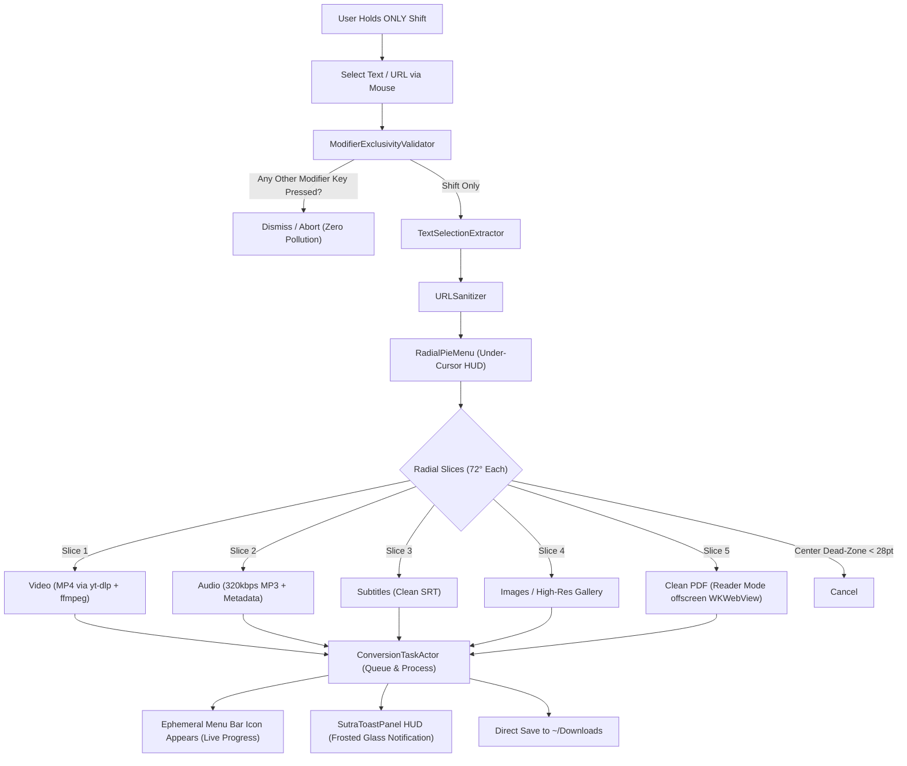

# SutraKey / Sutra Key (सूत्र)

<p align="center">
  
</p>

<p align="center">
  <strong>The invisible thread connecting text selection to instant media & document actions.</strong>
</p>

<p align="center">
  <a href="https://github.com/halcyon-past/SutraKey/stargazers"></a>
  <a href="https://github.com/halcyon-past/SutraKey/network/members"></a>
  <a href="https://github.com/halcyon-past/SutraKey/actions/workflows/ci-build-and-test.yml"></a>
  <a href="https://github.com/halcyon-past/SutraKey/blob/main/LICENSE"></a>
  <a href="https://developer.apple.com/macos/"></a>
  <a href="https://swift.org"></a>
  <a href="https://sutrakey.aritro.cloud"></a>
  
</p>

> 🧵 **SutraKey (also known as Sutra Key)**: Hold Shift + Select any URL to summon a radial wheel that downloads video, audio, subtitles, or clean PDFs straight to `~/Downloads`. Native Swift macOS utility. 100% Free & Open Source.

---

## ✦ Etymology & Philosophy

*"Sutra"* (सूत्र) is Sanskrit for a thread or string holding pearls together. *"Key"* represents the Shift key physical interaction. 

SutraKey (also written as **Sutra Key**) is designed as an extension of the macOS compositor: it runs completely invisibly (`LSUIElement = YES`), consumes **0% CPU** when idle, creates **no clutter** in the Dock or Menu Bar until needed, and reacts with zero latency to your muscular habit of holding Shift while highlighting text.



---

## ✦ Core Features

### 1. Dual Trigger Architecture (Gesture & Global Shortcut)
- **Mouse Gesture:** Hold `Shift` + click-and-drag to select any URL or link across macOS.
- **Global Hotkey:** Press **`⌘⇧S`** (`Cmd + Shift + S`) or **`⌥⇧S`** (`Option + Shift + S`) anywhere in your workspace (Terminal, WhatsApp, Slack, Apple Notes, VS Code) to capture highlighted text or clipboard URLs instantly.
- **Strict Exclusivity Guard:** A bitwise evaluation (`NSEvent.modifierFlags.intersection(.deviceIndependentFlagsMask)`) guarantees that mouse triggers ignore extraneous modifiers to avoid collision with standard system shortcuts.
- If you hit `Esc` or press another modifier key while the radial wheel is open, it dismisses instantly without stealing focus.

### 2. Under-Cursor Radial Pie Menu
- Frameless, transparent, non-activating `NSPanel` centered exactly at the cursor coordinates.
- Fluid 60fps spring animation with haptic alignment ticks (`NSHapticFeedbackManager.defaultPerformer`) as your cursor enters each slice.
- Center circular dead-zone (< 28pt) allows instantaneous flick-cancelling.

| Slice | Name | Target Format | Engine |
| :---: | :--- | :--- | :--- |
| **1** | **Video** | Highest resolution MP4 (Video + Audio merged) | `yt-dlp` + `ffmpeg` |
| **2** | **Audio** | 320kbps `.mp3` with embedded artwork | `yt-dlp` extract audio |
| **3** | **Subtitles** | `.srt` subtitle file | `yt-dlp --write-sub` |
| **4** | **Gallery** | High-res thumbnail or full album | `yt-dlp` / `gallery-dl` |
| **5** | **Clean PDF** | Ad-free reader-mode formatted PDF | Offscreen `WKWebView` |

### 3. Ephemeral Menu Bar Status
- When idle: **invisible** (no clutter in your menu bar).
- When a task begins: the monochrome template icon smoothly appears in the menu bar with real-time percentage or circular progress.
- Once all jobs finish, the icon automatically vanishes after a 1.5-second grace period.
- Clicking the status item reveals an `NSPopover` showing active downloads, live transfer speeds (`MB/s`), ETA, and a one-click cancel (`SIGTERM`) button.

### 4. Custom Frosted Glass Toast HUD
- Floating toast panel in the top-right corner beneath the menu bar (`.ultraThinMaterial`, hairline border, auto-dismiss 3.5s).
- **Start:** Displays format badge and host domain.
- **Finished:** Shows checkmark and one-click **"Show in Finder"** button.
- **Error:** Displays concise failure explanation and **"Copy Error Log"** button.

### 5. Strict Sandboxed Output
- Saves strictly into `~/Downloads`.
- Command arguments enforce `--no-exec` and `--restrict-filenames` to protect against path-traversal or malicious shell sequences.

---

## ✦ Installation

### Homebrew (Recommended)
```bash
brew install --cask halcyon-past/tap/sutrakey
```

Or tap first and install:
```bash
brew tap halcyon-past/tap
brew install --cask sutrakey
```

To upgrade:
```bash
brew upgrade --cask sutrakey
```

### Direct Download
- 🍏 **Universal DMG:** [SutraKey.dmg (Latest)](https://github.com/halcyon-past/SutraKey/releases/latest/download/SutraKey.dmg)
- 📦 **In-Place Auto-Updater ZIP:** [SutraKey.zip (Latest)](https://github.com/halcyon-past/SutraKey/releases/latest/download/SutraKey.zip)

### Direct Download (.dmg)
Download the latest notarized release from [sutrakey.aritro.cloud](https://sutrakey.aritro.cloud) or GitHub Releases.

### Build from Source
```bash
git clone https://github.com/halcyon-past/SutraKey.git
cd SutraKey
./Scripts/package_and_install.sh
```

---

## ✦ Documentation & Compliance

- 📖 **[Support & User Guide](docs/SUPPORT.md)** — Installation, Accessibility permission guide, shortcuts, and troubleshooting.
- 🔒 **[Privacy Policy](docs/PRIVACY_POLICY.md)** — Zero-telemetry on-device processing guarantees.
- 📜 **[Terms of Service](docs/TERMS_OF_SERVICE.md)** — Fair use guidelines and open-source terms.
- 🤝 **[Code of Conduct](CODE_OF_CONDUCT.md)** — Community standards and enforcement.
- 🛡️ **[Security Policy](SECURITY.md)** — Vulnerability reporting and process isolation.
- 📝 **[Changelog](docs/CHANGELOG.md)** — Release history and semantic versioning notes.

---

## ✦ Automated Verification & Tests

SutraKey includes strict unit test suites verifying every layer:

```bash
swift test
```

- **`ModifierExclusivityTests`:** Verifies bitwise rejection of modifier pollution (`Cmd+Shift`, `Opt+Shift`, etc.).
- **`RadialGeometryTests`:** Asserts exact 72° mathematical slice mapping and center dead-zone threshold (< 28pt).
- **`YTDLPProgressParserTests`:** Validates regex parsing of `yt-dlp` download percentage, speed, ETA, and post-processing states.
- **`EphemeralMenuBarStateTests`:** Ensures the menu bar icon is invisible when idle and reveals itself only during active workloads.
- **`URLSanitizerTests`:** Ensures URL cleaning, punctuation stripping, and valid scheme enforcement.
- **`DownloadsPathResolutionTests`:** Asserts strict target resolution to `~/Downloads` and path traversal safety.

---

## ✦ License & Privacy

- **License:** 100% Free & Open Source under the [MIT License](LICENSE).
- **Privacy:** 0% telemetry, 0 analytics trackers, 0 cloud dependencies. Read our full [Privacy Policy](docs/PRIVACY_POLICY.md).
- **Author:** [Aritro Saha](https://www.aritro.cloud/) ([@halcyon-past](https://github.com/halcyon-past))
